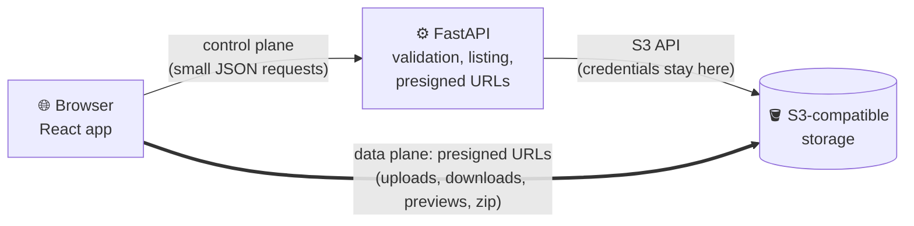

<div align="center">

# ☁️ CloudVault

**A fast, keyboard-friendly file manager for your own S3-compatible storage.**

Browse, upload, preview and organize files in AWS S3, Cloudflare R2, MinIO or any other S3-compatible bucket, from one clean web dashboard.


</div>

---

## Contents

- [Why CloudVault](#why-cloudvault)
- [Origin](#origin)
- [Features](#features)
- [How it works](#how-it-works)
- [Quick start](#quick-start)
- [Configuration](#configuration)
- [Bucket setup](#bucket-setup)
- [Using CloudVault](#using-cloudvault)
- [Keyboard shortcuts](#keyboard-shortcuts)
- [API overview](#api-overview)
- [Development](#development)
- [Project layout](#project-layout)
- [Deployment notes](#deployment-notes)
- [Limits and known gaps](#limits-and-known-gaps)

## Why CloudVault

Cloud consoles are built for administrators, not for everyday file work. CloudVault gives a bucket the feel of a desktop file manager (folders, drag and drop, right-click menus, cut/copy/paste, undo) while keeping the architecture small and honest:

- **Your storage stays the source of truth.** There is no database. Folders are key prefixes, and everything on screen is read from the bucket.
- **File data never goes through the API.** The browser talks to storage directly with short-lived presigned URLs, so large files are fast and the server stays tiny.
- **Credentials never leave the backend.** The React app only ever sees temporary links.
- **Provider independent.** AWS S3, Cloudflare R2 and MinIO work today. The S3 specifics live behind one storage abstraction.

It is built for a **single user**: one set of storage credentials, no accounts, no sharing.

## Origin

CloudVault began as a small coursework project: an assignment for a **Distributed Systems** course. The practical task asked for a simple client that uploads, downloads and lists objects in a cloud object storage bucket, using the AWS S3 SDK, MinIO or a local emulator, and to explain how that solution would scale in a real cloud deployment.

That first version did only those three things. It then grew well beyond the brief: folders, multipart and resumable uploads, previews, zip downloads, a trash with undo, and desktop-style keyboard navigation. It is now a full file manager for any S3-compatible bucket.

The coursework shaped the design, and its distributed-systems ideas are still visible in the code:

- **Object storage as the source of truth.** Folders are key prefixes and there is no database, which is the object-storage model the course contrasts with block and file storage.
- **Separate control and data planes.** The API only coordinates, and file bytes go straight between the browser and storage, as in large S3-style systems.
- **Planning for partial failure.** A move is a copy plus a delete with rollback, upload parts are retried, and an interrupted upload resumes from the parts storage already holds.

## Features

### 📁 Files and folders

- Grid and list views, sorting, instant filter-as-you-type search, and category filters (documents, images, media).
- **Search the folder or everything below it:** filtering is instant for the open folder, and a toggle extends the search to all subfolders (files and folders by name, with where each result lives). The search is kept in the address (`?p=docs&q=report&deep=1`), so it can be bookmarked, shared or reloaded.
- Breadcrumb navigation with the folder shown in the URL, so back, forward and bookmarks work.
- Create, rename, move and copy files **and whole folders**; drag items onto a folder to move them.
- Multi-select with click, Ctrl/⌘+click, Shift+click, select all and invert selection.
- A details panel with size, type, modified date, ETag, object key and the real content type read from storage.
- Paginated listings that load more as you reach the end of a large folder.

### ⬆️ Uploads

- Pick files or a **whole folder**, or drop them anywhere on the page. Dropped folder trees keep their structure, including empty folders.
- Direct browser-to-storage transfer through presigned URLs, with live progress, cancel and retry.
- **Multipart uploads** for large files: parts are sent in parallel, each retried with backoff and a fresh URL, so a flaky connection does not restart a 4 GB upload.
- **Resume after a refresh**: an interrupted upload is listed as unfinished; choose the same file again and only the missing parts are sent.
- Name conflicts are never silent: replace or skip one file or all of them.

### 👀 Previews

- Double-click or press Enter to preview **images, video, audio, PDFs and text or code** without downloading.
- Step through the other previewable files in the folder with ← / →.
- Long text files show their first 256 KB and stop downloading there.

### ⬇️ Downloads

- One file downloads directly from storage.
- **Folders and multi-selections download as a zip built in your browser** (files are fetched straight from storage and streamed into the archive; the API only lists and signs). Chrome and Edge stream to disk; other browsers build the zip in memory up to 1 GiB. Progress and cancel are built in.

### 🗑️ Trash and undo

- Deleting moves items to a reserved `.cloudvault-trash/` folder instead of erasing them. A toast offers **Undo**, and **Ctrl/⌘+Z** undoes the last delete.
- A **Trash page** restores items to where they were (never overwriting anything) or deletes them for good.
- **Shift+Delete** deletes permanently after a confirmation.

### ⌨️ Desktop-style interaction

- Full keyboard navigation modelled on Windows Explorer: arrow keys, Home/End, PageUp/PageDown, type-ahead, Shift/Ctrl selection modes.
- **Cut, copy and paste** between folders, with a paste bar and "cut" items shown faded.
- Right-click menus on files, folders and the empty space around them.
- Click selects, double-click opens, like a real file manager (a tap opens folders on touch screens).
- A built-in cheat sheet: press <kbd>?</kbd>.

### 🎨 Polish

- Light and dark themes, responsive layout with a slide-in navigation drawer on small screens.
- Loading, empty and error states everywhere, with retry.
- Accessible by default: roles and labels on the list, focus restored after actions, dialogs that close predictably.

## How it works



| Plane | Path | Carries |
| --- | --- | --- |
| **Control** | Browser → FastAPI → storage | Listings, folder operations, copy/move, trash, and *requests for* presigned URLs |
| **Data** | Browser → storage | The actual bytes of uploads, downloads, previews and zip contents |

Design decisions worth knowing:

- **Folders are prefixes.** Creating a folder writes a zero-byte `name/` marker; moving or copying a folder copies every object under the prefix.
- **Key safety.** The backend normalizes every key, rejects traversal and malformed paths, and refuses to touch the reserved trash prefix outside the trash endpoints.
- **Move is copy + delete**, with rollback if a step fails, because S3 has no rename.
- **Trash is just a prefix.** Deleted items move to `.cloudvault-trash/<batch id>/<original key>` with a small JSON manifest, so no database is needed to restore them.
- **Zip files are built client-side.** The server never buffers or proxies file contents, which keeps memory flat and the data plane direct.

## Quick start

### Requirements

- Node.js 20+ and [pnpm](https://pnpm.io)
- Python 3.11+ and [uv](https://docs.astral.sh/uv/)
- An S3-compatible bucket (for local development, [MinIO](https://min.io) is easiest)

### 1. Backend

```bash
cd api
cp .env.example .env     # then fill in your storage settings
uv sync
uv run fastapi dev
```

The API serves on `http://127.0.0.1:8000`, with interactive docs at `/docs`.

### 2. Frontend

```bash
cd web
pnpm install
pnpm dev
```

Open `http://localhost:5173`. The dev server proxies `/api` to the backend.

### 3. Allow the browser to reach your bucket

Uploads, previews and zip downloads go straight from the browser to storage, so the bucket needs a CORS rule. See [Bucket setup](#bucket-setup).

## Configuration

Backend settings live in `api/.env` (a template is in `api/.env.example`). Never commit the real file.

| Variable | Description |
| --- | --- |
| `STORAGE_PROVIDER` | `minio`, `s3` or `r2` |
| `S3_ENDPOINT` | Endpoint URL (omit for AWS S3) |
| `S3_REGION` | Region (`auto` for R2) |
| `S3_BUCKET` | Bucket name |
| `S3_ACCESS_KEY` | Access key (required) |
| `S3_SECRET_KEY` | Secret key (required) |
| `S3_ADDRESSING_STYLE` | `path` or `virtual` |
| `MAX_UPLOAD_BYTES` | Optional upload size limit (default 5 GiB) |
| `CORS_ORIGINS` | JSON list of allowed frontend origins, e.g. `["http://localhost:5173"]` |
| `LOG_LEVEL` | Logging level (default `INFO`) |

### Provider examples

<details>
<summary><b>MinIO (local)</b></summary>

```env
STORAGE_PROVIDER=minio
S3_ENDPOINT=http://localhost:9000
S3_REGION=us-east-1
S3_BUCKET=cloudvault
S3_ADDRESSING_STYLE=path
S3_ACCESS_KEY=minioadmin
S3_SECRET_KEY=minioadmin
```

</details>

<details>
<summary><b>Cloudflare R2</b></summary>

```env
STORAGE_PROVIDER=r2
S3_ENDPOINT=https://<account-id>.r2.cloudflarestorage.com
S3_REGION=auto
S3_BUCKET=my-bucket
S3_ADDRESSING_STYLE=path
S3_ACCESS_KEY=...
S3_SECRET_KEY=...
```

</details>

<details>
<summary><b>AWS S3</b></summary>

```env
STORAGE_PROVIDER=s3
S3_REGION=eu-west-1
S3_BUCKET=my-bucket
S3_ADDRESSING_STYLE=virtual
S3_ACCESS_KEY=...
S3_SECRET_KEY=...
```

</details>

The frontend has one optional setting, `VITE_API_BASE_URL` (see `web/.env.example`), used when the API is not served from the same origin.

## Bucket setup

### CORS (required)

Allow your frontend origin to `PUT` (uploads) and `GET` (previews and zip downloads).:

```json
[
  {
    "AllowedOrigins": ["http://localhost:5173"],
    "AllowedMethods": ["GET", "PUT"],
    "AllowedHeaders": ["*"],
    "MaxAgeSeconds": 3600
  }
]
```

Replace the origin with your real frontend origin in production.

### Lifecycle rules (recommended)

Nothing leaves the trash on its own, and an interrupted multipart upload leaves its parts behind (the bucket keeps and bills them until they are aborted). Add two rules:

| Rule | Prefix | Action |
| --- | --- | --- |
| Empty the trash automatically | `.cloudvault-trash/` | Expire objects after, for example, 30 days |
| Clean up abandoned uploads | whole bucket | Abort incomplete multipart uploads after a few days |

## Using CloudVault

### Previews

Double-click a file, or press Enter on it, to look at it without downloading: images, video, audio, PDFs and text or code (the first 256 KB). The arrow keys or the on-screen buttons step through the other previewable files in the folder. The browser reads the file straight from storage, so what it can show depends on your browser and on the content type stored with the file. Files it cannot show are downloaded on double-click.

### Resuming uploads

Files over 64 MiB are sent in parts. If the page is refreshed or the tab closes part-way, the upload appears as **unfinished** in the upload panel. Choose **Resume…** and pick the same file again; only the parts missing from storage are sent.

- A browser cannot keep a file across a refresh, so the file is matched by **name, size and modified time**.
- The list of unfinished uploads is kept in the browser's local storage, so another browser or profile will not see it.
- An upload left for more than 7 days is aborted when the page loads.
- If storage no longer has the upload, it simply starts over.

### Trash

Deleting moves items to the reserved `.cloudvault-trash/` folder. It is hidden from the file list, and the API refuses to touch it except through the trash endpoints. A toast offers **Undo**, and the **Trash** page in the sidebar restores items or deletes them for good. Restoring never overwrites: if the name is taken again, the item stays in the trash. Files over 5 GiB go to the trash too: storage copies them in parts, which can take a while.

### Downloading folders

Folders and multi-selections download as a single zip. The API lists the files and signs the links (up to 10,000 files per archive); your browser fetches them and writes the zip. In Chrome and Edge the archive streams to a file you choose, so size is not limited by memory. Other browsers build it in memory, up to 1 GiB.

## Keyboard shortcuts

Shortcuts work like a desktop file manager and switch off while you type in a field. On a Mac, <kbd>Ctrl</kbd> is <kbd>⌘</kbd>. Press <kbd>?</kbd> in the app for this list.

| Group | Action | Keys |
| --- | --- | --- |
| **Move around** | Move between items | <kbd>↑</kbd> <kbd>↓</kbd> <kbd>←</kbd> <kbd>→</kbd> |
| | First / last item | <kbd>Home</kbd> / <kbd>End</kbd> |
| | Up / down a page | <kbd>PgUp</kbd> / <kbd>PgDn</kbd> |
| | Jump to a name | type its first letters |
| | Open folder / preview file | <kbd>Enter</kbd> |
| | Up one folder | <kbd>Backspace</kbd> or <kbd>Alt</kbd>+<kbd>↑</kbd> |
| | Search this folder | <kbd>/</kbd> or <kbd>Ctrl</kbd>+<kbd>E</kbd> |
| **Select** | Select the item | <kbd>Space</kbd> |
| | Add or remove the item | <kbd>Ctrl</kbd>+<kbd>Space</kbd> |
| | Extend the selection | <kbd>Shift</kbd>+<kbd>↑</kbd> / <kbd>↓</kbd> |
| | Move without selecting | <kbd>Ctrl</kbd>+<kbd>↑</kbd> / <kbd>↓</kbd> |
| | Select all / invert | <kbd>Ctrl</kbd>+<kbd>A</kbd> / <kbd>Ctrl</kbd>+<kbd>I</kbd> |
| | Clear selection | <kbd>Esc</kbd> |
| **Work with items** | Rename | <kbd>F2</kbd> |
| | Download (folders and selections as a zip) | <kbd>Ctrl</kbd>+<kbd>D</kbd> |
| | Copy / cut / paste here | <kbd>Ctrl</kbd>+<kbd>C</kbd> / <kbd>X</kbd> / <kbd>V</kbd> |
| | Move to trash | <kbd>Delete</kbd> |
| | Delete forever | <kbd>Shift</kbd>+<kbd>Delete</kbd> |
| | Undo the last delete | <kbd>Ctrl</kbd>+<kbd>Z</kbd> |
| | Open the item's menu | <kbd>Shift</kbd>+<kbd>F10</kbd> or <kbd>Menu</kbd> |
| **Upload and view** | New folder | <kbd>Alt</kbd>+<kbd>N</kbd> |
| | Upload files / a folder | <kbd>Ctrl</kbd>+<kbd>U</kbd> / <kbd>Ctrl</kbd>+<kbd>Shift</kbd>+<kbd>U</kbd> |
| | Refresh | <kbd>F5</kbd> or <kbd>Ctrl</kbd>+<kbd>R</kbd> |
| | Show keyboard shortcuts | <kbd>?</kbd> |

## API overview

All routes live under `/api`. Interactive documentation is served at `/docs` when the API is running.

| Area | Endpoint | Purpose |
| --- | --- | --- |
| Health | `GET /health` | Service and storage connection status |
| Objects | `GET /objects` | List a folder (paginated, with folder prefixes) |
| | `GET /objects/search` | Find files and folders by name in a folder and all its subfolders |
| | `GET /objects/metadata` | Metadata for one object |
| | `POST /objects/presign-upload` | Presigned PUT URL for a single-request upload |
| | `GET /objects/presign-download` | Presigned GET URL for one object |
| | `POST /objects/presign-downloads` | Presigned GET URLs for up to 100 objects |
| | `POST /objects/copy` · `POST /objects/move` | Copy or move one object |
| | `DELETE /objects` | Permanently delete one object |
| Folders | `POST /folders` · `DELETE /folders` | Create a folder, or delete one with its contents |
| | `POST /folders/copy` · `POST /folders/move` | Copy or move a folder tree |
| | `GET /folders/tree` | Every file under a prefix (used for zips) |
| Multipart | `POST /uploads/multipart` | Start an upload; the server picks the part size |
| | `POST /uploads/multipart/parts` | Presigned URLs for specific parts |
| | `GET /uploads/multipart/parts` | Parts already stored (for resuming) |
| | `POST /uploads/multipart/complete` · `/abort` | Assemble or discard an upload |
| Trash | `POST /trash` · `GET /trash` | Move items to the trash, list the trash |
| | `POST /trash/{id}/restore` | Restore a batch |
| | `DELETE /trash/{id}` · `DELETE /trash` | Delete one batch, or empty the trash |

Errors are returned as predictable JSON with a user-safe message. Storage credentials, stack traces and provider internals are never included in responses.

## Development

### Tests

```bash
cd api && uv run pytest     # backend (storage service, validation, trash, multipart, API)
cd web && pnpm test         # frontend (Vitest + Testing Library)
```

### Code style

Both projects are formatted and linted with tools that run the same way for everyone: [Ruff](https://docs.astral.sh/ruff/) for Python, and [Prettier](https://prettier.io) with [oxlint](https://oxc.rs/docs/guide/usage/linter) for TypeScript.

```bash
cd api && uv run ruff format . && uv run ruff check .    # format, then lint
cd web && pnpm format && pnpm lint && pnpm typecheck     # format, lint, type-check
```

Use `uv run ruff check --fix .` to apply safe lint fixes, and `pnpm format:check` / `uv run ruff format --check .` to check formatting without changing files (useful for CI).

### Production build

```bash
cd web && pnpm build        # type-checks, then writes web/dist
```

## Project layout

```text
cloudvault/
├── api/
│   ├── app/
│   │   ├── api/routes/          # thin HTTP routes (objects, folders, uploads, trash, health)
│   │   ├── core/                # settings and shared limits
│   │   ├── schemas/             # Pydantic request/response models
│   │   └── services/storage/    # storage abstraction + S3 implementation (trash, keys, errors)
│   └── tests/
└── web/
    └── src/
        ├── components/          # shared UI (common/, layout/)
        ├── features/            # files/, folders/, upload/, preview/, trash/
        ├── hooks/               # app-wide hooks
        ├── lib/                 # pure helpers (keymap, paths, zip planning, pending uploads…)
        ├── pages/               # page-level composition
        ├── services/            # backend API + direct transfer clients
        └── types/               # shared TypeScript types
```

## Deployment notes

The frontend calls the API under `/api` on its own origin. In production, serve `web/dist` and the API behind one reverse proxy, or set `VITE_API_BASE_URL` at build time and add the frontend origin to `CORS_ORIGINS`.

> ⚠️ **There is no authentication yet.** Anyone who can reach the API can read and change the whole bucket. Keep it off the public internet, or put it behind a VPN or an authenticating reverse proxy.

Security notes:

- Storage credentials exist only in the backend environment and are never returned by any endpoint or logged.
- Presigned URLs are short-lived, and the API does not log them in full.
- Restrict `CORS_ORIGINS` and the bucket CORS rule to your real frontend origin.

## Limits and known gaps

| Limit | Value |
| --- | --- |
| Single upload size | 5 GiB by default (`MAX_UPLOAD_BYTES`), sent in parts above 64 MiB |
| Files per zip download | 10,000 |
| Zip built in memory (non-Chrome/Edge) | 1 GiB |
| Items per delete request | 200 |
| Copy, move or trash a single file | any size (over 5 GiB it is copied in parts inside storage, so it takes longer) |
| Text preview | first 256 KB |
| Search of the subfolders | stops after 300 matches or 50,000 objects read, and says so |

Not built yet: authentication, undo for moves, renames and pastes, restoring a single item from a deleted batch, progress for large folder moves, and touch drag-and-drop.
